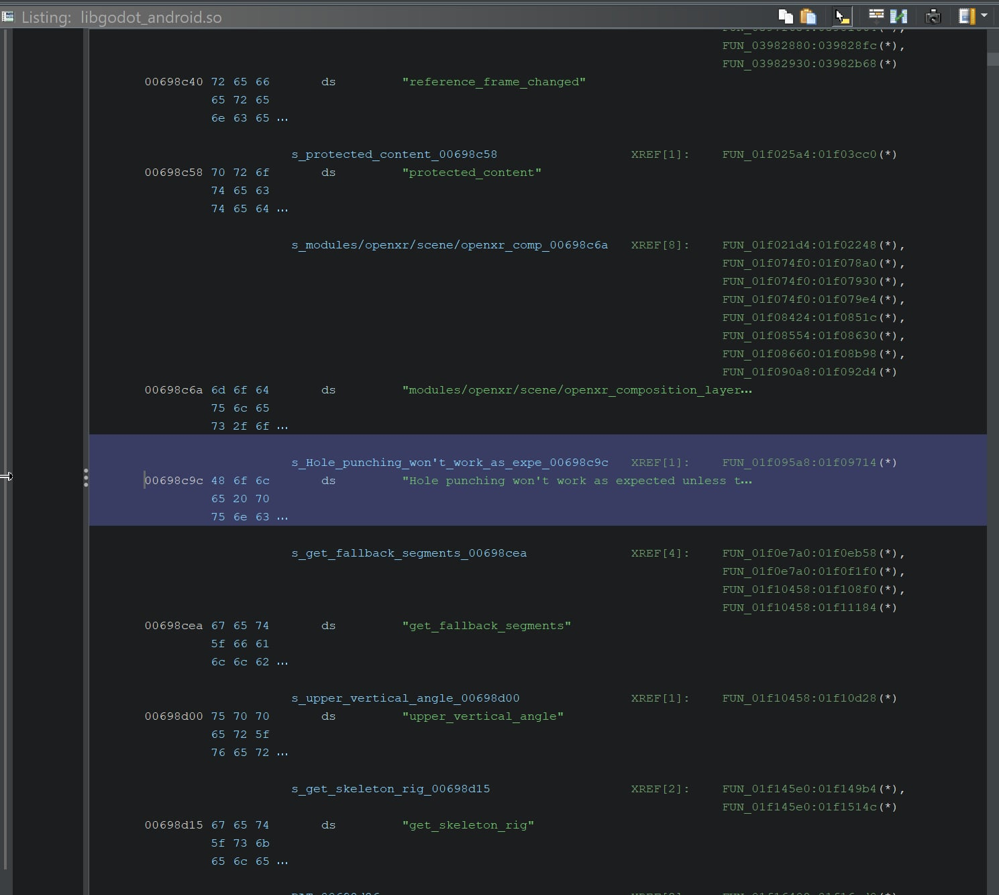
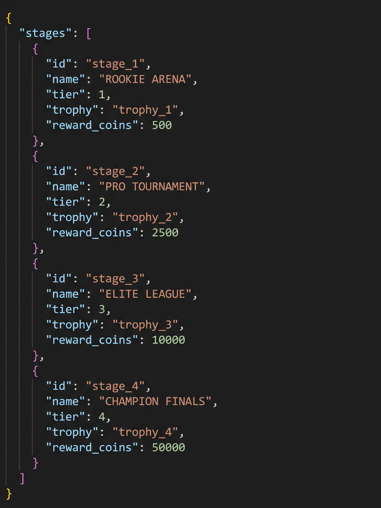
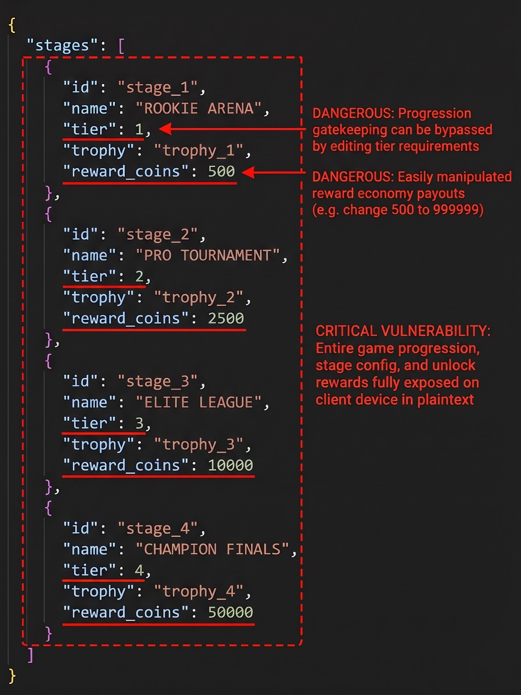
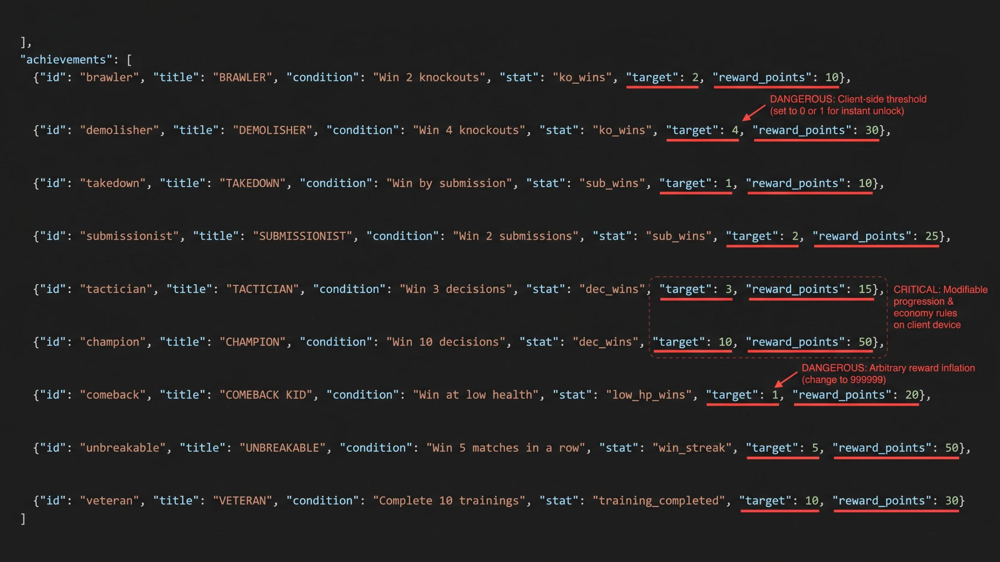
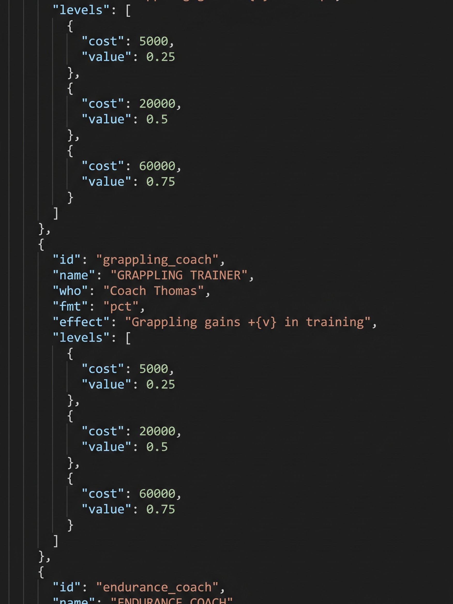
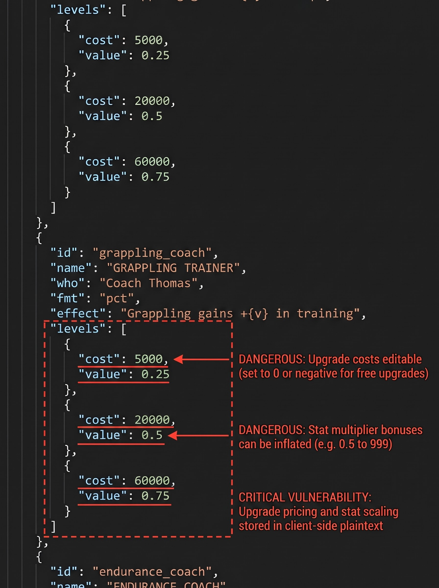
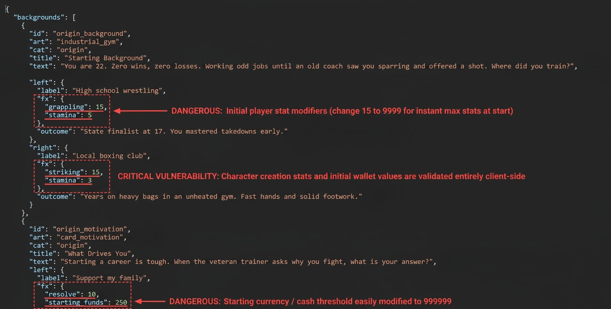
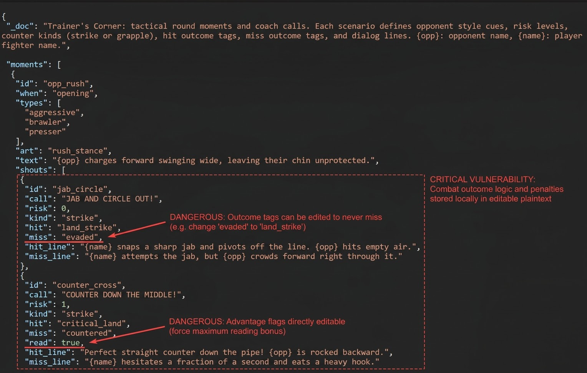
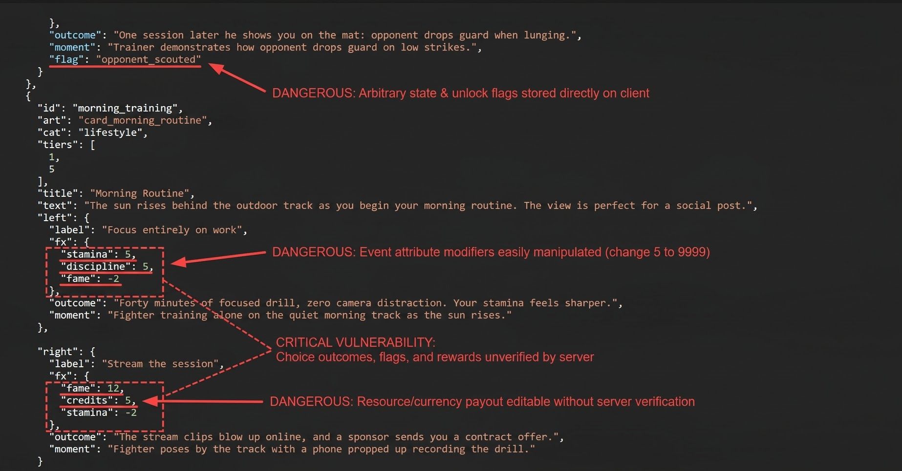
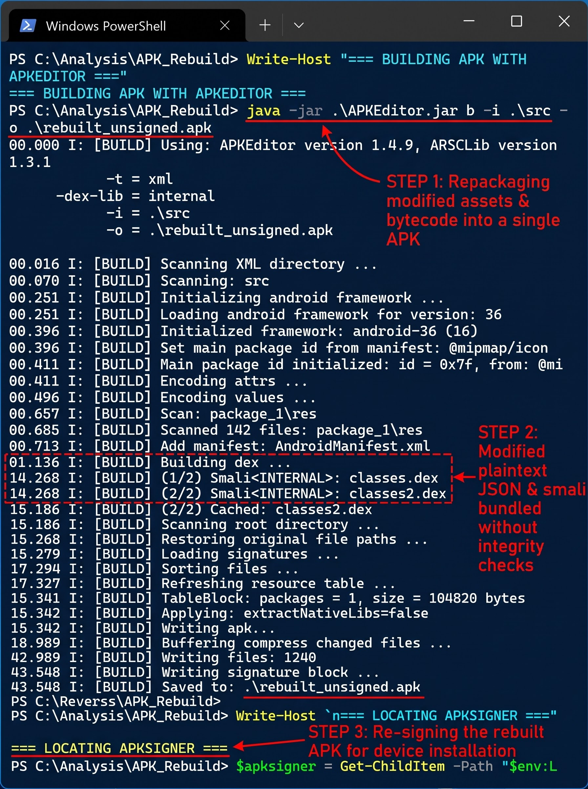

# Mobile Game Teardown: Why Secure Programming Matters

**Or: How I found a game's entire economy sitting in plain text—and how devs can prevent it.**

Uhm, I assume you probably forgot my name, but never my skills, you little decent reverse engineer.

While scrolling Instagram and making full use of its completely non-human enslavement algorithms, I came across a video game ad. It caught my eye, which is rare. Okay, maybe not, but it looked like a cool game, so I downloaded it right away.

To my surprise, it had very few downloads. I even did the usual shady digging on the internet, and nope, no modified APK anywhere for me to enjoy being overpowered. So I started playing it legit, only to get bothered by its currency system and how many red flags it had. I even tried the classic trick of changing my phone's clock to see if the game would catch on. It didn't. I said to myself, "Hell, what kind of security is this?"

Spoiler alert: even your crypto-miner laptop is safer than this game.

Today, we're going to see just how important secure programming is, and how much serious damage skipping it can do.

> **Disclaimer:** All of this is strictly for educational purposes. I will purposely show altered code segments and heavily modified names, and I will track you down if you try to use anything in this article against indie developers. As for the billionaires? Ehhhh, let them handle it ;) Or hire me, guys, I don't mind becoming a billionaire too.

---

## Step 1: Merging and Unpacking the APK

First of all, the game was installed from the Google Play Store, meaning it's an Android App Bundle (Split APKs) rather than a single file. Imagine you have a building: instead of handing you the whole building, Google Play divides it into sections, floors, doors, and people. So we had to merge them first. With some basic skills, we bundled them back together into a single APK. Now, let's move over to our beloved PC.

We then unpacked the game and looked at the three main layers of any Android app:

- **`src\AndroidManifest.xml` & `src\res` (the app's blueprint and UI):** We decoded Android's binary XML (AXML) into human-readable text. This immediately exposed Google's Pairip anti-tamper wrapper (`com.pairip.application.Application` and `LicenseActivity`), a security guard that blocks modified or re-signed apps the second you launch them.
- **`src\smali\classes*` (the Android glue code):** We disassembled the Android bytecode (`classes.dex`, `classes2.dex`, `classes3.dex`) into editable `.smali` files. Think of this as translating machine instructions into readable assembly, exposing both Pairip's license check (`LicenseClient.smali`) and the billing bridge (`GodotGooglePlayBilling.smali`) that handles in-app purchases.
- **`src\root` (the raw engine and game files):** This extracted the untouched native libraries (`lib\arm64-v8a\*.so`) and the actual game assets (`assets\*`).

---

## Step 2: The Ghidra Rabbit Hole

Now, like a classic .exe reverse engineer, I fired up my beloved Ghidra (a heavy-duty tool used to dissect compiled C++ programs) and loaded `libgodot_android.so`. Terrible decision.

Since this isn't a tutorial, I'll skip the painful details. Let's just say I was staring straight at raw game-engine code rather than the game itself. Completely useless. Does that count as a layer of protection? Not really, and it only takes a few minutes to realize you're looking in the wrong place.

---

## Step 3: Checking the Assets (Where Everything Went Wrong)

So we pivoted to the assets folder to see if there was anything worth sniffing or modifying. Listing `src\root\assets\` revealed a Godot 4 Sparse PCK export (`assets.sparsepck`, which acts like a simple table of contents pointing to where files live) with every single game file sitting completely open on disk.

Amazing. Now let's see where they messed up horribly. According to Kerckhoffs's principle (a golden rule in security: a system should stay secure even if everyone knows how it works, as long as the secret key stays secret), relying on "security through obscurity" is something a (very offensive word) would do. So up to this point, no real mistakes yet, until we actually opened the files:

- **`data\*.json`** (`career.json`, `gym.json`, `fight.json`, `cards.json`): Opened directly as plain text, meaning the entire game economy was sitting in a regular notepad file with zero encryption.
- **`scripts\*.gd.remap`:** Plain-text index files acting like a cheat sheet, mapping every readable script path directly to its compiled version.
- **`scripts\*.gdc`:** Began with the standard GDSC header bytes (compiled GDScript bytecode compressed with ZSTD) rather than Godot's encrypted signature. In plain English: the code was packed for speed, not locked with a key.

Holy moly, you don't realize how much easier my life just got.

---

## What's Exposed? Everything.

The developer practically handed anyone, not even an attacker, just a curious unpacker, immediate access to their source code, images, logic, everything. Any decent reverse engineer can read these files and build a completely modified version: editing currency, bypassing in-app purchases, unlocking or altering stages, adding whatever they want, and even selling it as a mod.

Even worse? In today's AI-driven world, someone could effortlessly take this entire codebase, reskin it, and ship it as their own game. The developer put both themselves and their project at massive risk.

For example, take a look at what's sitting right there in plain sight:

### Fighting Stages & Payouts

We can literally see the exact configuration for the fighting stages and how much money each one rewards. Anyone can edit the first fight's purse and, boom, instant infinite money on the first try, or even add custom stages and mess with existing ones.

The achievements aren't any safer. Targets and reward points are just numbers sitting in the open.

### Upgrades & Costs

Right next to that, we see every upgrade and its exact price tag, wide open for anyone to tweak or zero out.

### Starting Stats

At the very end, we find the most dangerous piece of all: the player's starting stats. That one already explains itself...

### Combat Logic & Dialogue

Moving further, we see the exact fight mechanics, hit/miss lines, win conditions, and even the full story, dialogues, and starting bonuses.

### Event Cards

Finally, the cards file lays out literally every single in-game event and what it triggers. Amazing.

Since nothing in there is signed or checked, the modified files bundle straight back into an APK without any integrity complaints:

---

## How to Actually Secure Your Game

Today proves why secure programming matters, and how skipping it puts your entire game at extreme risk. This isn't just a rule for massive companies; every developer should practice it.

Am I saying your game will ever be 100% unbreakable? No. Even if the dev had encrypted everything, it would still be breakable with a simple runtime hooking tool like Frida. But would it have been as effortless as today's teardown? Not a chance.

Here are a few measures that would have made my life way harder:

- **Use encryption:** Encrypt your Godot PCK archive and sensitive JSON data instead of leaving plain-text files lying around.
- **Use server-side APIs:** Don't rely purely on local files for critical economy, currency, and progression values. Validate them through a server.
- **Basic packers:** Even a very simple packer would have bothered me, forcing me to either statically break the packer (annoying) or set up a dynamic environment on PC just to run and dump it (also annoying).
- **Code obfuscation:** Obfuscate your scripts and symbols so an unpacker isn't reading a neat, human-friendly manual of your game's internals.
- **Basic sanity checkers:** I'm not asking for Denuvo-style DRM here, just simple logic checks scattered inside your game code (not all dumped in the same obvious spot):
  - **Starting stat validation:** If every user (even VIPs) is supposed to start with the exact same base stats, flag or block any save file that loads with weird starting numbers.
  - **Playtime vs. progress equations:** Build a simple logical equation combining runtime and user stats. Ain't no way in this world a user playing for one minute, or even an hour, maxes out their wrestling stat.
  - **Hidden skill caps:** Set silent progression caps only you know about. For example, if Season 1 caps every skill level at 80, any hacker pushing past that gets caught immediately.

...and the list goes on.

Anyways, I'm done for today, and so are you.

See you once again,

Omar ;)
